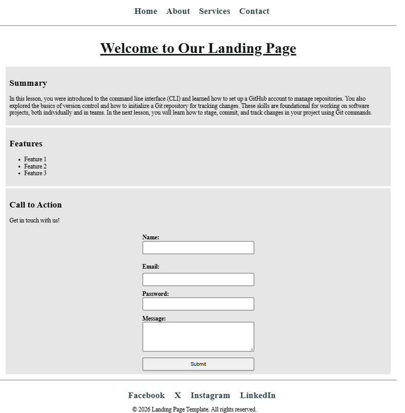
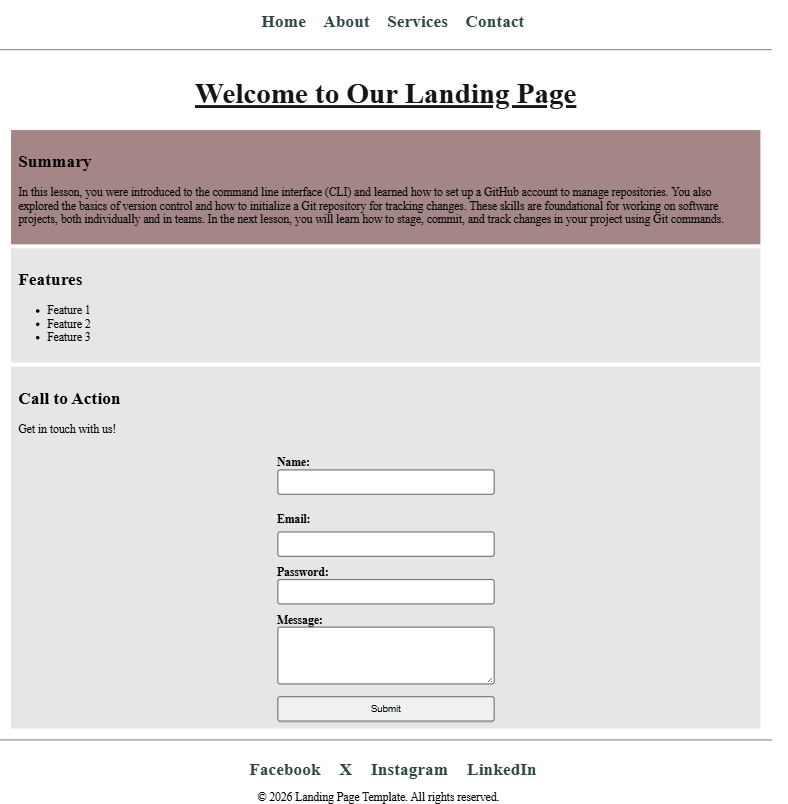

# Landing Page Template

A single page with a navigation bar, a summary, a short feature list, a contact form, and a footer.

## Description

The page is a fixed width and sits in the center of the window. Home, About, Services, and Contact stay on this page. The footer links open Facebook, X, Instagram, and LinkedIn in a new tab.

* **Summary** describes setting up the command line, a GitHub account, and a Git repository
* **Features** lists Feature 1, Feature 2, and Feature 3
* **Call to Action** says “Get in touch with us!” and shows a form

The form asks for a name, an email, a password, and a message. Every field is required. After the browser checks an entry, an invalid field gets a red border and a valid field gets a green border.

Hover turns the Summary block a muted brown. Features and Call to Action do the same. A nav or footer link turns teal and gains an underline.

## Screenshots

### The page

### Hover

## Getting Started

### Dependencies

* A browser

### Installing

No install step.

### Executing program

Open `index.html` in a browser.

## Help

Every form field is required. After the browser checks an entry, an invalid field gets a red border and a valid field gets a green border.

## Authors

[Mamadou Moussa Balde](https://www.linkedin.com/in/2mb/)

## Version History

* Current page
    * Fixed-width layout with summary, features, contact form, and footer

## License

This folder does not include a `LICENSE.md` file.

## Acknowledgments

* [README template](https://gist.github.com/DomPizzie/7a5ff55ffa9081f2de27c315f5018afc)
